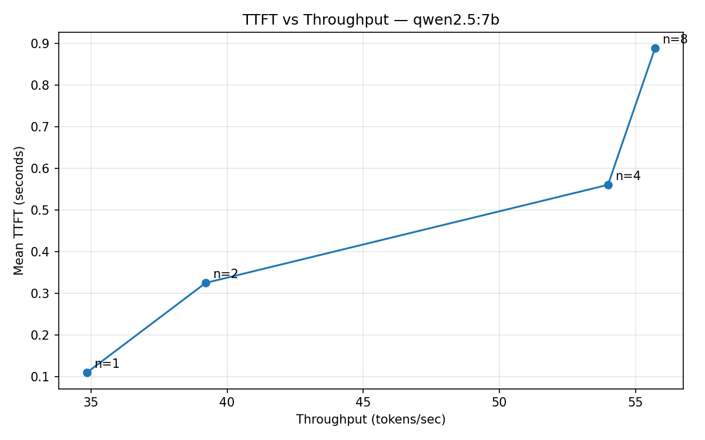

# Inference Benchmarking Harness

Measure the TTFT vs throughput tradeoff under concurrent load for local LLM inference servers (Ollama, llama.cpp).

## Method

Sweeps concurrency levels (e.g. 1, 2, 4, 8 simultaneous requests) against a local model server, measuring:

- **TTFT (time-to-first-token):** wall-clock time from request send to first streamed token
- **Throughput:** total output tokens across all concurrent requests / wall-clock time

Outputs a JSON results file and a TTFT-vs-throughput plot showing where the system saturates.

## Setup

```bash
python -m venv .venv && source .venv/bin/activate
pip install -r requirements.txt
```

Requires a running Ollama server:

```bash
OLLAMA_NUM_PARALLEL=8 ollama serve
```

## Usage

```bash
python run.py --model qwen2.5:7b --levels 1 2 4 8
python run.py --model qwen2.5:3b --levels 1 2 4 8 16 --max-tokens 256 --prompt short
```

To sample prompts from ShareGPT instead of repeating one fixed prompt (downloaded to the
Hugging Face cache on first use, ~650 MB):

```bash
python run.py --model qwen2.5:7b --dataset sharegpt --tokenizer Qwen/Qwen2.5-7B-Instruct --ignore-eos
```

Each request gets a different prompt, and `max_tokens` is set to the length of that
conversation's original reply. `--tokenizer` is the Hugging Face repo whose tokenizer
counts those lengths. `--ignore-eos` asks the server to generate exactly that many tokens,
so every engine does the same work; requests that still stop short are counted as
`early_stops`.

### Open-loop mode

`--levels` runs closed-loop batches: each level waits for every request to finish, so the
client never sends faster than the server answers. `--rates` instead sends requests on a
Poisson schedule at a fixed rate and never waits, the way real traffic arrives:

```bash
python run.py --model qwen2.5:7b --dataset sharegpt --tokenizer Qwen/Qwen2.5-7B-Instruct \
  --ignore-eos --rates 0.5 1 2 4 --num-requests 100
```

`--arrival-cv` sets how uneven the gaps between requests are (standard deviation / mean):
1 is Poisson (the default), 0 evenly spaced, above 1 bursty. vLLM's `--burstiness` is
1 / cv². Every request is recorded with
its scheduled and actual send time, and failures (HTTP errors, timeouts, dropped connections)
are recorded with a label instead of stopping the run. The run warns if the client itself fell
behind the schedule or its event loop stalled, since either would distort the timestamps.

Add `--slo-ttft-ms` / `--slo-tpot-ms` to report goodput: the share of requests that met both
targets, with failures counted as misses. Each rate prints TTFT, TPOT and inter-token latency
(p50/p99), throughput, goodput and whether the run was stable: a line fitted to the number of
requests in flight over the run may grow by at most 5% of the requests that arrived.

`analyze.py` recomputes those metrics from saved results, so you can change the trim or the
targets without rerunning, and can plot several runs together (e.g. two engines):

```bash
python analyze.py results/openloop_A.json results/openloop_B.json --labels vLLM SGLang \
  --slo-ttft-ms 500 --slo-tpot-ms 50 --plot results/compare.png
```

### Knee search

`--find-knee` searches for the highest arrival rate the server sustains. With SLOs, it's the
highest rate where at least 90% of requests meet them.

```bash
python run.py --model qwen2.5:7b --dataset sharegpt --tokenizer Qwen/Qwen2.5-7B-Instruct \
  --ignore-eos --find-knee --slo-ttft-ms 1000 --slo-tpot-ms 50
```

Each probe is one open-loop run at a single rate, with at least 100 requests and at least
60 seconds. A probe fails if it is unstable, misses the attainment target, or is stopped early
because enough requests have already missed their targets that the probe can't pass.

1. **Bracket:** start at 1 / the latency of a lone request and double until a probe fails.
2. **Bisect:** probe the geometric midpoint until the failing rate is within 10% of the
   passing one.
3. **Confirm:** re-probe the passing rate.

The result is a range: "passes at X req/s, fails at Y". `cluster/knee_vllm.sbatch` runs it
against vLLM, under Slurm or directly on a GPU machine.

### Settings

Every methodology setting lives in `harness/config.py`: arrival pattern, window trim,
stability tolerance, attainment, probe sizes, search limits, warning thresholds and ShareGPT
filters. Each one is labelled with where its default comes from (convention, statistics,
judgment or safety) and why. Override them with a TOML file:

```toml
# my_settings.toml
trim = 0.05
probe_min_seconds = 120
```

```bash
python run.py ... --config my_settings.toml
```

The command-line flags `--arrival-cv`, `--trim` and `--attainment` take precedence over the
file. Every results file stores the full set of settings it was produced with, and
`analyze.py` re-analyzes each file with its own settings unless you override them.

Results (JSON plus a PNG plot) are written to `results/`.

## Key findings

### (qwen2.5:7b on Apple M2 Pro, 11.8 GiB)

With the default `NUM_PARALLEL=1`, Ollama serializes requests. Throughput stays flat
at ~34 tps regardless of concurrency, and TTFT grows linearly (28s at n=8) -- pure
queueing delay with zero batching benefit.

With `NUM_PARALLEL=8`, batching is enabled. The server reads weight matrices once and
applies them to multiple sequences per forward pass, amortizing memory bandwidth:

| Concurrency | Mean TTFT | Throughput (tok/s) |
|-------------|----------:|-----------:|
| 1           | 0.11s     | 34.9       |
| 2           | 0.33s     | 39.2       |
| 4           | 0.56s     | 54.0       |
| 8           | 0.89s     | 55.7       |



### Saturation and roofline analysis

Throughput plateaus at ~55 tps (n=4 to n=8 gained only 3%).

LLM token decoding is memory-bandwidth-bound. The arithmetic intensity (FLOPs per byte
transferred) is low at small batch sizes.

**Stats**:

- **M2 Pro memory bandwidth:** 200 GB/s
- **qwen2.5:7b (Q4 quantized):** 4.7 GB on disk
- **Theoretical peak (batch=1):** 200 / 4.7 = ~42 tok/s
- **Observed (batch=1):** 35 tok/s (~83% efficiency, remaining overhead from KV cache reads and scheduling)

With batching, weights are read once and applied to N sequences per forward pass,
amortizing the bandwidth cost. If weight reads were the only bottleneck, batch=4
would give ~4x throughput (170 tps). Instead we observe 54 tps (1.54x).

**KV cache:** Each sequence maintains key/value activations
across all layers. At batch=8, KV cache reads grow large enough to compete with
weight reads for memory bandwidth. This is why throughput flatlines at ~55 tps. The bandwidth
budget is consumed by KV cache, not weights.

Beyond n=8, TTFT would climb with no throughput gain.

### Benchmarking methodology

- A warmup request runs before the sweep to avoid cold-start bias (model loading
  inflated the first TTFT by ~12s in initial runs)
- Each concurrency level runs to completion (barrier synchronization) before the
  next level starts, ensuring clean per-level measurements
- Token counts come from the API's usage field, not local tokenization